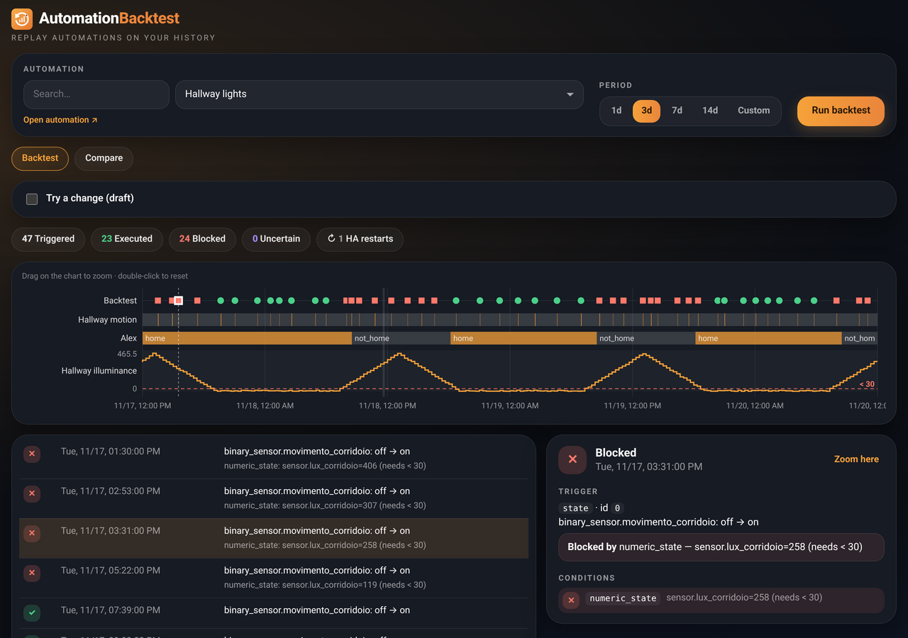
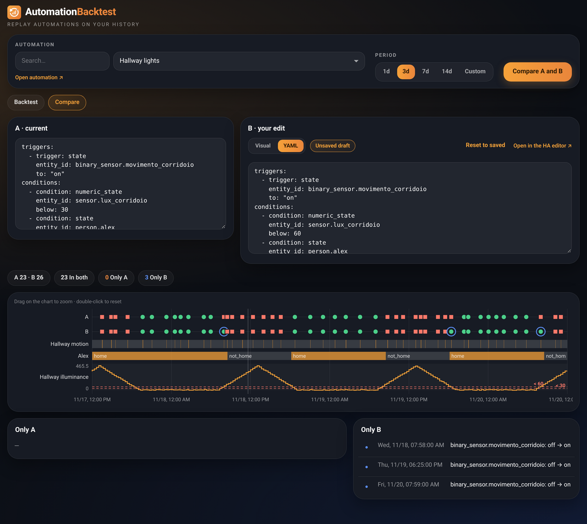
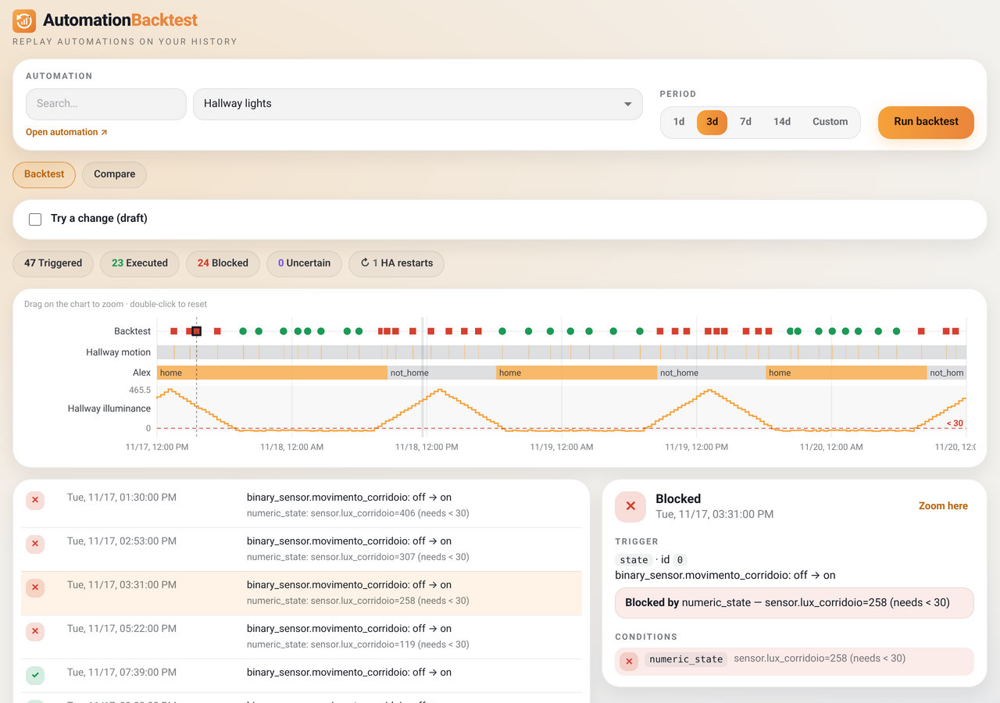
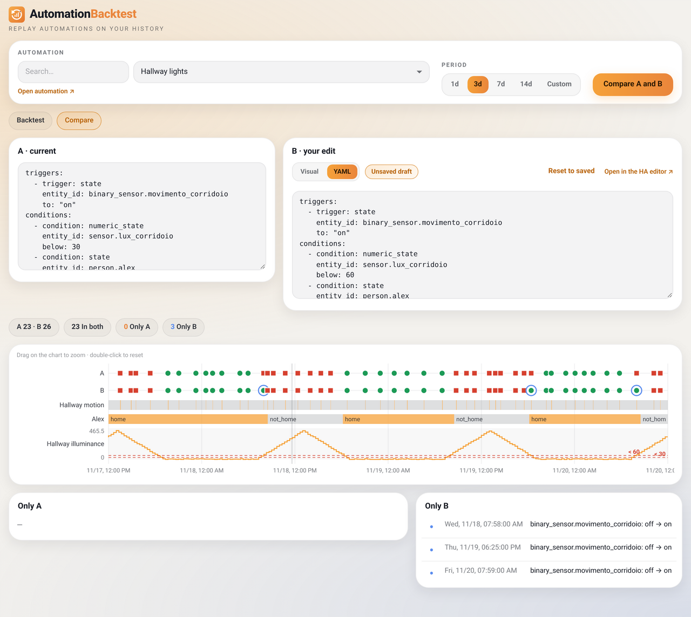

<div align="center">

<picture>
  <source media="(prefers-color-scheme: dark)" srcset="https://raw.githubusercontent.com/Thonno/ha-automation-backtest/main/custom_components/automation_backtest/brand/dark_logo@2x.png">
  
</picture>

# Automation Backtest for Home Assistant

**Test your automations against your own history before you trust them.**

Replay any automation, or a draft you haven't saved yet, over the days your recorder already holds. See when it would have run, which condition blocked it each time, and what changes if you edit it. Nothing is executed: no light flips, no notification goes out.

[](https://my.home-assistant.io/redirect/hacs_repository/?owner=Thonno&repository=ha-automation-backtest&category=integration)
[](https://my.home-assistant.io/redirect/config_flow_start/?domain=automation_backtest)

[](https://github.com/sponsors/Thonno)
[](https://buymeacoffee.com/aascione956)
[](https://github.com/Thonno/ha-automation-backtest/stargazers)

[](https://hacs.xyz/)

[](https://github.com/Thonno/ha-automation-backtest/releases)


</div>

---

> **Languages:** English and Italian. The panel follows the language set in Home Assistant (any other language falls back to English). More translations are welcome, see [Contributing](#contributing).

<details>
<summary><b>Dark theme</b></summary>

**Backtest**

[](https://raw.githubusercontent.com/Thonno/ha-automation-backtest/main/docs/backtest_dark.png)

**Compare A/B**

[](https://raw.githubusercontent.com/Thonno/ha-automation-backtest/main/docs/compare_dark.png)

</details>

<details>
<summary><b>Light theme</b></summary>

**Backtest**

[](https://raw.githubusercontent.com/Thonno/ha-automation-backtest/main/docs/backtest_light.png)

**Compare A/B**

[](https://raw.githubusercontent.com/Thonno/ha-automation-backtest/main/docs/compare_light.png)

</details>

*Screenshots use made-up demo data.*

## Why

You write or tweak an automation and then wait a week to find out whether it works. Or it fires at 3 AM and you have no idea why. Home Assistant's traces only show runs that actually happened. Automation Backtest answers the other questions:

- **When would it have run** in the last N days?
- **Why didn't it run?** For every time it triggered and stopped, the condition that blocked it, with the value it saw (`sensor.hallway_lux=412, needs < 30`).
- **What if I change it?** Edit the trigger or a condition and see exactly which runs appear, disappear or move.
- **Would this new automation have worked?** Build one you haven't created yet and see when it *would have run if it had existed*.

## Features

- **Sidebar panel** (admins only) with a timeline of every would-be run (✓ executed, ✕ blocked, ◆ uncertain), the entities the automation depends on, the thresholds it uses as dashed lines, and Home Assistant restarts as grey bands. Drag to zoom, double-click to reset.
- **Full condition trace** for each run, with the blocking condition highlighted.
- **What it would have done**: the actions are dry-run for every executed run (service calls, delays, `choose`/`if`, `repeat`, `variables`, `stop`), and the entities they control get their own lanes, **Real**, **Simulated** or **Both**. Simulated is the state each entity would have had if only this automation had driven it, with `mode: single / restart / queued` taken into account. Check an automation in seconds instead of waiting a week.
- **Drafts with Home Assistant's own editor**: tick *Try a change* to edit triggers, conditions and actions with the same visual blocks (entity pickers, durations, states) as the real automation editor, or in YAML. Nothing is saved.
- **New automations**: *＋ New automation (draft)* lets you build and backtest something that doesn't exist yet, actions included.
- **Save from the panel**: *Save as new automation* (with a name) or *Save* over the existing one (asks to confirm), through Home Assistant's own automation API. Or *Create / Open in the HA editor* to continue there: the editor opens **pre-filled with your draft**, unsaved, and you save it from there.
- **Compare A/B**: the saved automation against your draft over the same period. Runs only in A, only in B, and **shifted** runs (same cause, different time, e.g. after changing a `for:`) with the delta.
- **⋮ → Backtest** in *Settings → Automations* and in the automation editor. From the editor it takes the configuration **as it is on screen, unsaved changes included**.
- **Restarts are modelled**: no runs while Home Assistant was down, pending `for:` timers dropped, triggers re-attached afterwards, just like the real thing.
- **Never silently wrong**: anything that can't be replayed faithfully is marked *uncertain* with the reason, or listed as an unsupported trigger. It never guesses.
- **Actions** (`automation_backtest.run`, `automation_backtest.compare`) for scripts and Developer tools.
- **Read-only and local**: it only reads the recorder. No cloud, no extra database, nothing written.

## Requirements

- Home Assistant 2024.10 or newer (purpose-specific triggers need 2025.12+, like in HA itself)
- The **recorder** (enabled by default). History depth = your `purge_keep_days` (default 10 days).
- [HACS](https://hacs.xyz) for the recommended installation

## Installation

### HACS (recommended)

Click the first button at the top of this page to open the repository directly in your Home Assistant's HACS, then download it and restart. Or do it by hand:

1. In HACS open the menu (⋮) → **Custom repositories**.
2. Add `https://github.com/Thonno/ha-automation-backtest` with type **Integration**.
3. Search for **Automation Backtest**, download it, then restart Home Assistant.
4. Go to **Settings → Devices & services → Add integration → Automation Backtest** (or click the second button at the top). There is nothing to configure.

### Manual

Copy `custom_components/automation_backtest` into your Home Assistant `config/custom_components/` folder, restart Home Assistant, then add the integration as in step 4 above.

## First steps

1. Open **Backtest** from the sidebar (or ⋮ → **Backtest** on any automation).
2. Pick an automation and a period (1, 3, 7, 14 days or custom) and press **Run backtest**.
3. Click a red ✕ to see which condition stopped it and what value it saw.
4. Tick **Try a change (draft)**, adjust a threshold or a `for:`, run again, then open the **Compare** tab to see the difference.
5. Happy with it? **Open in the HA editor** and make the same change there.

Direct link to an automation: `/automation-backtest?automation=automation.your_automation`.

## What can be simulated

| | Supported | Not yet |
|---|---|---|
| **Triggers** | `state` (from/to/not_from/not_to/attribute/for), `numeric_state` (above/below/attribute/value_template/for, crossing semantics), `time` (fixed times, `input_datetime`, `weekday`), `time_pattern`, `template` (incl. `for`, `now()` re-rendered every minute), `sun` (sunrise/sunset with offset), `event` (event type + event data, from the recorder), `tag`, `homeassistant` (start/shutdown), `device` triggers that map to a state or attribute (turned on/off, motion, open/close, lock, vacuum, climate HVAC mode, sensor thresholds…) | `mqtt`, `webhook`, `zone`, `geo_location`, `calendar`, `conversation`, button/remote device triggers, templated `event_type` |
| **Purpose-specific** (HA 2025.12+) | `vacuum.started_cleaning`, `media_player.volume_changed`, `light.turned_on`, `door.opened`, `motion.detected`, `temperature.crossed_threshold`, `sun.sunrise`, `sun.sunset`, `vacuum.is_docked`, `select.is_option_selected`, `battery.is_charging`, `temperature.is_value`… (all of HA's purpose-specific conditions) with `target` (entity, device, area, floor, label), `behavior` (each/first/all, any/all), `for` and `threshold` (any/above/below/between/outside) | `moon.*`, `calendar.*`, `todo.*`, `zone.*`, golden/blue hour, timer events, counter limits, `button.is_being_held` |
| **Conditions** | `state` (incl. `for`, `match: any`, attribute), `numeric_state`, `time` (after/before/weekday, across midnight), `sun` (before/after with offsets), `template`, `trigger` (id), `and`/`or`/`not` (incl. shorthand), `device` conditions that map to a state or attribute | `zone` |
| **Templates** | `states()`, `states.domain.object`, `is_state`, `state_attr`, `is_state_attr`, `has_value`, `now()`, `today_at`, `as_timestamp`, `as_datetime`, `float/int/bool` with defaults, `iif`, `trigger.*` | the rest of HA's template API |

Sun times are calculated by Home Assistant itself for your home location, so they match the live triggers to the second. Event triggers need the event type to be in the recorder (it records all events unless you excluded them).

The engine has been checked against real runs on a live installation: for every automation it could simulate, the backtest matched the automation's actual run count exactly, restarts included.

## Limits worth knowing

- **History depth = your recorder.** Entities excluded from the recorder have no history.
- **Actions are only dry-run**: nothing is executed. Common services are simulated (on/off/toggle, brightness, covers, locks, climate, `input_*`, counters, timers, media, vacuums); scripts, scenes, `wait_*`, device actions other than on/off and custom services are listed as *not simulated*. Triggers and conditions still see the real history, so an automation that reacts to its own actions is not modelled.
- `input_datetime` used in a `time` trigger is read at the start of the window.
- A `for:` uses recorded timestamps; very short values may be affected by how often a device reports.
- The ⋮ menu entries are added by a small script, because Home Assistant has no official extension point for those menus. It fails silently: if a future release changes the menus, the entry disappears until it is updated and the sidebar panel keeps working.

## Actions

Everything the panel does is also available as actions, e.g. from *Developer tools → Actions*.

```yaml
# Backtest an existing automation
action: automation_backtest.run
data:
  automation: automation.hallway_lights
  days: 7
```

```yaml
# Backtest a draft that isn't saved
action: automation_backtest.run
data:
  days: 3
  config:
    triggers:
      - trigger: state
        entity_id: binary_sensor.hallway_motion
        to: "on"
    conditions:
      - condition: numeric_state
        entity_id: sensor.hallway_lux
        below: 30
```

```yaml
# Compare the saved version (A) with an edit (B)
action: automation_backtest.compare
data:
  automation: automation.heating_morning
  days: 14
  config_b:
    triggers:
      - trigger: numeric_state
        entity_id: sensor.living_temperature
        below: 19.5
    conditions:
      - condition: time
        after: "06:00"
        before: "09:00"
```

The response contains `summary` (triggered / executed / blocked / uncertain), a human-readable `timeline`, the `runs` with the full condition trace and `blocked_by`, `warnings`, `unsupported_triggers` and the `restarts` it found. `compare` adds `only_a`, `only_b` and `shifted`.

## How it works

`custom_components/automation_backtest/engine/` is a standalone, pure-Python, event-driven simulator (it only depends on `jinja2`) with its own test suite. The integration loads from the recorder the history of every entity the automation refers to, plus the events and restarts in the period, merges state changes, scheduled times, sun events and `for:` timers into one time-ordered queue, and evaluates triggers and conditions at the exact moment they would have been evaluated live.

## Changelog

See [CHANGELOG.md](CHANGELOG.md) for what changed in each release.

## Contributing

Issues and pull requests are welcome, especially:

- **Automations that give a different result from reality.** Please include the automation YAML (with entity names changed if you like) and what really happened. These are the most useful reports.
- **Triggers and conditions in the "Not yet" column.**
- **Translations of the panel.** The panel is a single dependency-free web component, `custom_components/automation_backtest/frontend/automation-backtest-panel.js`; its strings are in the tables at the top of the file.

To run the tests:

```bash
pip install -r requirements_test.txt
pytest
```

## Support

Automation Backtest is free and always will be. If it saves you time and you'd like to say thanks, you can [buy me a coffee](https://buymeacoffee.com/aascione956) or [sponsor me on GitHub](https://github.com/sponsors/Thonno) – entirely optional, and much appreciated.

<a href="https://buymeacoffee.com/aascione956"></a>

## License

[MIT](LICENSE) – free to use, modify and share, as long as the copyright notice is kept.
